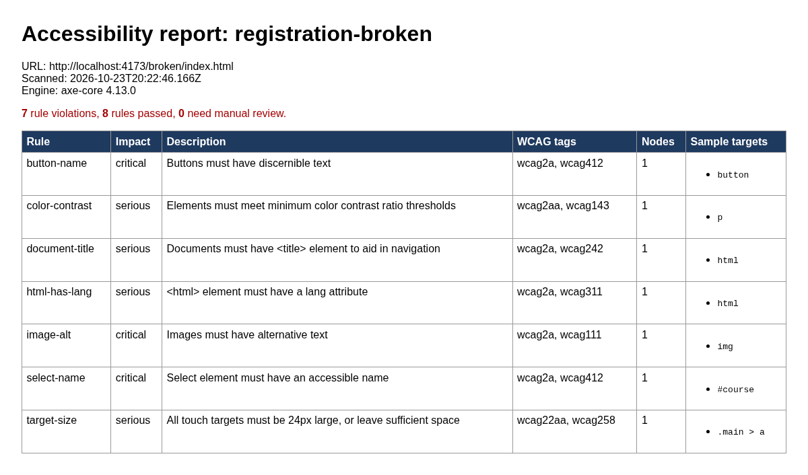
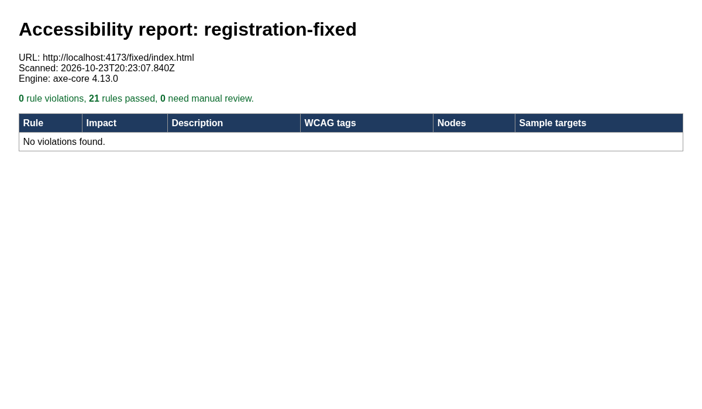

# a11y-playwright-axe

[](../../actions)

An automated accessibility test framework built on **Playwright (TypeScript)** and **@axe-core/playwright**. It scans pages against **WCAG 2.0/2.1/2.2 Level A and AA** rules and adds keyboard tests (focus order, focus visibility, skip links) that axe can't check by itself.

The repo includes a small **demo site in two versions**. `demo-site/broken/` has common defects built in on purpose, and `demo-site/fixed/` is the corrected version. Running the suite against each one shows the checks catching real issues and then passing once they're fixed.

> Automated tools find only part of the WCAG issues on a page. This framework is meant to support manual testing with a keyboard and screen readers (JAWS, NVDA, VoiceOver), not to replace it.

## Features
- **WCAG 2.2 AA axe scans.** The tag set lives in `a11y.config.json` (`wcag2a`, `wcag2aa`, `wcag21a`, `wcag21aa`, `wcag22aa`), so it includes the 2.2 Target Size rule.
- **Page-object model.** `pages/BasePage.ts` holds the shared scan and keyboard helpers, and `pages/RegistrationPage.ts` holds the page-specific locators.
- **Keyboard tests:** expected Tab order (2.4.3), keyboard operability (2.1.1), a visible focus indicator (2.4.7), and a skip link (2.4.1).
- **Configurable URLs.** Set named targets in `a11y.config.json`, or scan any URLs with `A11Y_URLS="https://a.gov,https://b.gov"`.
- **Reports.** Each run produces a Playwright HTML report (`reports/html`), JSON results (`reports/results.json`), and a per-page axe report in both HTML and JSON (`reports/axe/*.html|json`).
- **CI.** A GitHub Actions workflow requires the fixed site to pass and the broken site to fail, then uploads the reports as artifacts.

## Quickstart
```bash
npm ci
npx playwright install --with-deps chromium
npm run test:fixed    # all 5 tests pass
npm run test:broken   # all 5 tests fail, by design
npm run report        # open the Playwright HTML report
A11Y_URLS="https://www.section508.gov" npx playwright test tests/axe-scan.spec.ts
```

## Defects seeded in the broken demo
| Defect | WCAG SC | Caught by |
|---|---|---|
| Missing `lang`, missing `<title>` | 3.1.1, 2.4.2 | axe |
| Image with no alt text | 1.1.1 | axe |
| Low-contrast text | 1.4.3 | axe |
| Icon-only button with no name; unlabeled select | 4.1.2 | axe |
| Small inline link target | 2.5.8 (new in 2.2) | axe |
| Clickable `div` used as a button | 2.1.1 | keyboard test |
| Positive `tabindex` that scrambles the order | 2.4.3 | focus-order test |
| `outline: none` on focus | 2.4.7 | focus-visible test |
| No skip link or landmarks | 2.4.1 | skip-link test |

## Sample output
```
npm run test:broken
  ✘ axe WCAG 2.2 AA scan: registration
    + "button-name (critical) x1", "color-contrast (serious) x1", "document-title (serious) x1",
    + "html-has-lang (serious) x1", "image-alt (critical) x1", "select-name (critical) x1",
    + "target-size (serious) x1"
  ✘ focus order matches expected DOM/visual order
  ...
  5 failed

npm run test:fixed
  5 passed
```

### Report screenshots
Broken site:



Fixed site:



## Project layout
```
a11y.config.json      targets, page lists, WCAG tags, expected focus order
pages/                page objects
tests/                axe-scan.spec.ts, keyboard.spec.ts
utils/                config loader and HTML/JSON report writer
demo-site/broken|fixed
.github/workflows/a11y.yml
```

## License
MIT © Geoffrey Montague
